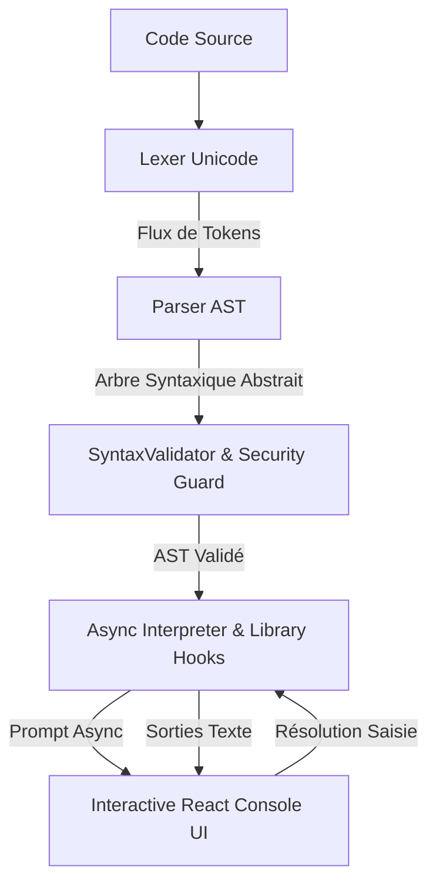

# Spécification Technique et Pédagogique — KalanCode Library (`klncd`) V1.0

- **Version :** 1.0.0
- **Statut :** Validé et intégré dans le frontend
- **Type :** Moteur d'interprétation sécurisé pour l'apprentissage du code en Bamanankan et N'Ko

---

## 1. Vision et Objectifs Pédagogiques

Pour enseigner l'informatique aux débutants absolus au Mali et en Afrique de l'Ouest, l'exécution arbitraire de code via `eval()` ou un backend non supervisé présente des risques majeurs de sécurité et de complexité conceptuelle.

`klncd` (KalanCode Core Library) V1.0 résout ce défi en offrant :
1. **Un moteur d'interprétation synchrone/asynchrone déterministe** fonctionnant 100% côté client sans `eval()` ni `new Function()`.
2. **Une syntaxe d'inspiration Python épurée**, simple à lire, prédisposant les apprenants à la programmation réelle.
3. **Deux primitives fondamentales indispensables** :
   - `klncd.S3b3n(valeur)` : Affichage / écriture sur la console (du verbe *sɛbɛn* / *ߛߓߍ* = écrire).
   - `klncd.Doon(question)` : Saisie interactive bloquante du point de vue de l'algorithme, suspendue de manière non-bloquante pour l'UI React via promesse asynchrone (du verbe *don* / *ߘߏ߲߬* = entrer / introduire).
4. **Soutien natif multilingue et multi-scripts** :
   - Préservation stricte des caractères Bamanankan latins (`ɛ, ɔ, ɲ, ŋ`) dans les identifiants et les chaînes.
   - Support complet de l'alphabet N'Ko (`ߒߞߏ`, `U+07C0` à `U+07FA`).

---

## 2. Grammaire Formelle EBNF (V1.0)

```ebnf
Program             ::= StatementList
StatementList       ::= ( Statement | NEWLINE )*
Statement           ::= ImportStatement | AssignmentStatement | CallStatement

ImportStatement     ::= "import" "klncd"
AssignmentStatement ::= Identifier "=" Expression
CallStatement       ::= CallExpression

CallExpression      ::= "klncd" "." ( "S3b3n" | "Doon" ) "(" ArgumentList? ")"
ArgumentList        ::= Expression ( "," Expression )*

Expression          ::= AdditiveExpression
AdditiveExpression  ::= MultiplicativeExpression ( ( "+" | "-" ) MultiplicativeExpression )*
MultiplicativeExpression ::= PrimaryExpression ( ( "*" | "/" ) PrimaryExpression )*

PrimaryExpression   ::= NumberLiteral
                      | StringLiteral
                      | Identifier
                      | CallExpression
                      | "(" Expression ")"

Identifier          ::= [a-zA-Z_\u0080-\uFFFF][a-zA-Z0-9_\u0080-\uFFFF]*
NumberLiteral       ::= [0-9]+ ( "." [0-9]+ )?
StringLiteral       ::= '"' [^"\n\r]* '"' | "'" [^'\n\r]* "'"
Comment             ::= "#" [^\n\r]*
```

---

## 3. Primitives de la Bibliothèque Officielle

### 3.1 `klncd.S3b3n(valeur)`
- **Rôle :** Affiche une valeur ou le résultat d'une expression dans la console KalanCode.
- **Arité :** Exactement 1 argument.
- **Retour :** `null`.
- **Exemples :**
  ```python
  import klncd
  klncd.S3b3n("I ni ce kulu!")
  klncd.S3b3n(25)
  klncd.S3b3n(10 + 5 * 2)
  ```

### 3.2 `klncd.Doon(question)`
- **Rôle :** Pose une question à l'apprenant dans la console, suspend l'interpréteur jusqu'à la soumission de la réponse, et renvoie la saisie sous forme de chaîne de caractères.
- **Arité :** Exactement 1 argument.
- **Retour :** `string` (valeur saisie par l'utilisateur).
- **Exemple de dialogue :**
  ```python
  import klncd
  jamu = klncd.Doon("I jamu?")
  klncd.S3b3n("I ni ce, " + jamu)
  ```

---

## 4. Pipeline Architectural de l'Interpréteur

L'exécution suit un pipeline strict en 5 couches :



1. **Lexer (`lexer.ts`)** :
   - Analyseur lexical à états finis préservant les glyphes N'Ko et Bamanankan.
   - Ignore les espaces et les commentaires `#`.
   - Localise précisément la ligne et la colonne de chaque token pour un signalement d'erreurs clair.
2. **Parser (`parser.ts`)** :
   - Analyseur syntaxique descendant récursif générant un AST typé (`Program`, `ImportStatement`, `AssignmentStatement`, `CallExpression`, `BinaryExpression`, `Literal`, `Identifier`).
3. **SyntaxValidator & Security Guard (`validator.ts`)** :
   - Vérifie la présence obligatoire de `import klncd`.
   - Rejette toute importation de module externe (`import os`, `import math`, etc.).
   - Rejette tout appel de fonction non autorisée (seules `S3b3n` et `Doon` sont permises).
   - Vérifie la conformité de l'arité des fonctions.
4. **Environment (`environment.ts`)** :
   - Table des symboles isolée par session, garantissant l'absence de fuite d'état entre exécutions.
5. **Interpreter (`interpreter.ts`)** :
   - Boucle d'évaluation asynchrone non-bloquante.
   - Limite stricte de budget d'instructions (défaut : 10 000 étapes) pour neutraliser les boucles infinies.
   - Prise en charge des tokens d'annulation (`abort()`).
   - Évaluation binaire avec coercition sécurisée pour la concaténation de chaînes.
   - Surlignage de la ligne courante en temps réel (`onHighlightLine`).

---

## 5. Matrice de Validation des 12 Scénarios Officiels

Tous les scénarios sont automatisés dans `frontend/src/klncd/__tests__/compliance_12_scenarios.test.ts` :

| # | Scénario Testé | Expression / Code | Statut |
|---|----------------|-------------------|--------|
| **1** | Afficher une chaîne | `klncd.S3b3n("I ni ce kulu!")` | ✓ Validé |
| **2** | Afficher un nombre | `klncd.S3b3n(25)` | ✓ Validé |
| **3** | Priorité des opérateurs | `klncd.S3b3n(10 + 5 * 2)` $\rightarrow$ `20` | ✓ Validé |
| **4** | Demander une valeur | `dugu = klncd.Doon("I be dugu jumɛn na?")` | ✓ Validé |
| **5** | Stockage dans variable | `jamu = klncd.Doon("I jamu?")` $\rightarrow$ Traoré | ✓ Validé |
| **6** | Réutiliser la variable | `klncd.S3b3n(jamu)` $\rightarrow$ Traoré | ✓ Validé |
| **7** | Concaténation de chaînes | `klncd.S3b3n("I ni ce, " + jamu)` $\rightarrow$ "I ni ce, Diarra" | ✓ Validé |
| **8** | Fonction inconnue | `klncd.Inconnue("test")` $\rightarrow$ Rejet `ValidationError` | ✓ Validé |
| **9** | Erreur de syntaxe | `klncd.S3b3n("ouvert)` $\rightarrow$ Rejet `LexerError` | ✓ Validé |
| **10** | Module non autorisé | `import math` $\rightarrow$ Rejet `SecurityError` | ✓ Validé |
| **11** | Préservation Bamanankan | `tɔgɔ_ɲuman = "Mamadou Kɔnɛ"` (`ɛ, ɔ, ɲ, ŋ`) | ✓ Validé |
| **12** | Préservation N'Ko | `ߕߐ߯ = klncd.Doon(...)` (`ߒߞߏ`) | ✓ Validé |

---

## 6. Composants d'Interface Développés

1. **`KalanCodeConsole.tsx`** :
   - Écran de terminal avec styles dark/amber/green rétro-futuriste.
   - Formulaire interactif intégré apparaissant lorsque `klncd.Doon()` est invoqué.
   - Badges d'état dynamiques (`idle`, `running`, `waiting_input`, `completed`, `error`).
   - Boutons d'action : Annulation de l'exécution en cours, Effacement de la console.
2. **`KalanCodePlayground.tsx`** :
   - Espace de travail en deux colonnes (Éditeur de code avec numérotation de lignes + Console interactive).
   - Sélecteur de programmes prédéfinis :
     - *Dialogue Hamed (S3b3n & Doon)*
     - *Calculatrice arithmétique*
     - *Script N'Ko natif (ߒߞߏ)*
   - Statistiques en direct (lignes, statut, temps d'exécution).
3. **`App.tsx`** :
   - Onglet 1 : **Atelier klncd (S3b3n & Doon)**.
   - Onglet 2 : **Parcours Kalan (7 Unités interactives)**.
   - Onglet 3 : **Lecteur de Leçon Approfondi**.
